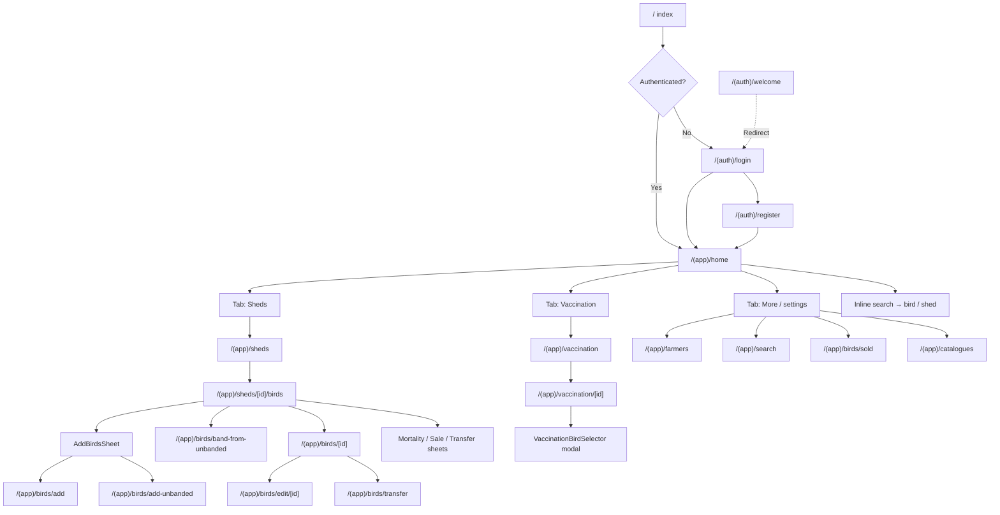
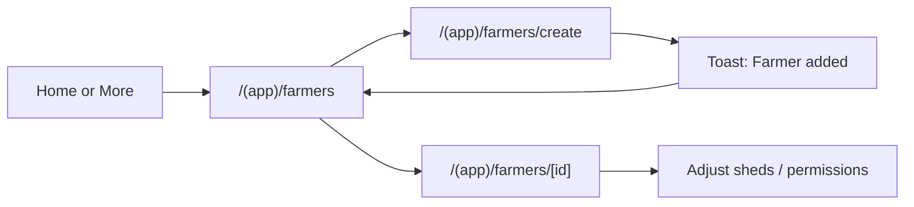
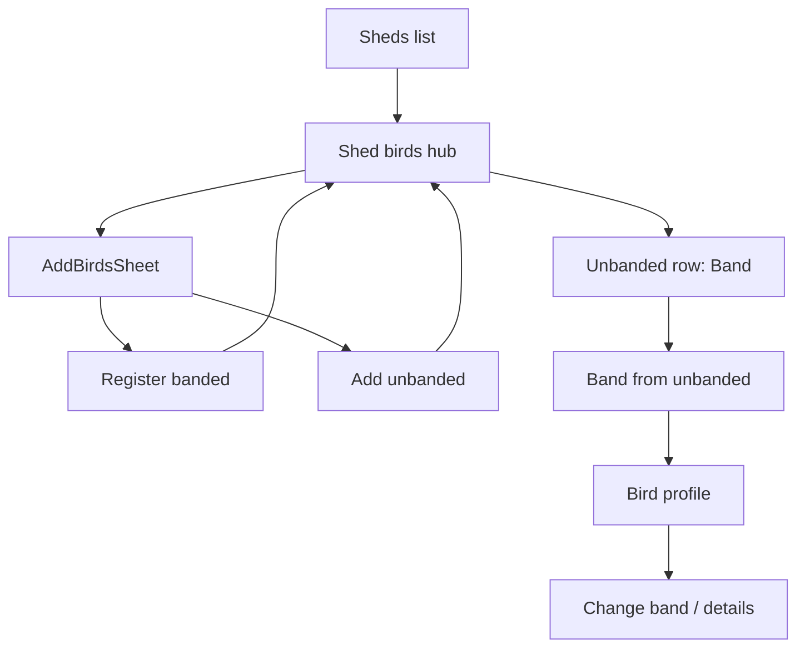
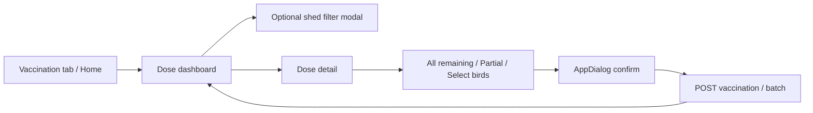

# Poultry Vaccine Tracker — Screen Inventory, Navigation Audit & Minimum-Click UX Report

**Document type:** Investigation and reporting only (no code, schema, API, permission, or navigation changes).  
**Scope:** Mobile Expo app (`mobile/`) with backend permission/API evidence where needed.  
**Date:** 2026-10-31  
**Method:** Static analysis of Expo Router routes, layouts, `router.push` / `Link` references, permission gates, and workflow screens. Tap counts below are **estimated from code structure**, not measured on a device unless marked otherwise.

---

## 1. Executive summary

PoultryTrack is a shed-centric Expo Router app. Authenticated users land on **Home**, with primary tabs **Sheds**, **Vaccination** (permission-gated), and **More**. Bird operations (add, band, lifecycle) concentrate on **Shed management** (`/(app)/sheds/[id]/birds`). Vaccination recording concentrates on the Vaccination tab and dose detail screen.

### Headline counts (verified)

| Category | Count | Notes |
|----------|------:|-------|
| Expo Router route files under `mobile/app/` | **40** | Includes 2 layouts + 38 route modules |
| Unique full screens with real UI | **34** | Excludes boot/redirect-only stubs |
| Redirect-only / boot stubs | **4** | `index`, `welcome`, `birds/search`, `sheds/[id]` |
| Primary tab destinations (visible UI) | **3–4** | Home, Sheds*, Vaccination*, More (*permission-gated) |
| Full-flow modals / action sheets | **7** | See §3.3 |
| Reusable non-screen UI (representative) | **20+** | Forms, dialogs, pickers — not counted as screens |
| Implemented but not linked from live UI | **9** | Legacy flock/group/lifecycle routes + dead component refs |
| Duplicate / overlapping workflows | **4 clusters** | Transfer; search; populations vs shed; lifecycle sheets vs routes |

### Three biggest opportunities to reduce clicks

1. **Bird onboarding** — Collapse “Add birds → chooser → form → back to shed” into a shed-anchored fast entry (banded / unbanded) with fewer screens and retained “save & next”.
2. **Vaccination recording** — Make overdue/due doses one tap from Home or Vaccination into a pre-filled “All remaining” record path; keep confirm only for irreversible or ambiguous coverage.
3. **Farmer onboarding** — Default Field-worker / Shed-lead presets with sheds assigned up front; avoid a second visit to farmer detail for basic readiness.

### Decisions needed from you

1. Retire or keep deep-linkable legacy routes (`flocks/*`, `birds/new-group`, `lifecycle-bulk/batch`, etc.)?
2. Should farmers be grantable `bird.update` in the mobile permission UI (currently omitted from `FARMER_PERM_OPTIONS`)?
3. Unify transfer UX (profile full screen vs shed `TransferActionSheet`)?
4. Should Home remain the search hub, with More → Search demoted or removed?

---

## 2. Repository and navigation architecture

### 2.1 Entry points

| Layer | Path | Role |
|-------|------|------|
| Expo entry | `mobile/package.json` → `expo-router/entry` | App bootstrap |
| Root layout | `mobile/app/_layout.tsx` | Providers + root Stack |
| Boot redirect | `mobile/app/index.tsx` | → Home if authed, else Login |
| Auth screens | `mobile/app/(auth)/*` | No dedicated auth `_layout.tsx` |
| App shell | `mobile/app/(app)/_layout.tsx` | Auth gate + Tabs |

### 2.2 Root stack (`mobile/app/_layout.tsx`)

```
Stack
├── index                 (boot redirect)
├── (auth)/welcome        (redirect → login)
├── (auth)/login
├── (auth)/register       (header: “Create farm”)
└── (app)                 (Tabs shell)
```

### 2.3 App tabs (`mobile/app/(app)/_layout.tsx`)

| Tab | Route | Visibility |
|-----|-------|------------|
| Home | `home` | Always (when authenticated) |
| Sheds | `sheds/index` | `shed.view` else `href: null` |
| Vaccination | `vaccination/index` | `vaccination.view` else `href: null` |
| Populations | `flocks/index` | Always `href: null` (legacy / deep-link) |
| More | `settings` | Always |

All other app routes are registered as **hidden** Tabs screens (`href: null`, `headerShown: false`) so they participate in history without appearing in the tab bar.

### 2.4 Role model (verified)

Source: `mobile/src/features/auth/permissions.ts`

- **Owner:** `hasPermission` always true.
- **Farmer:** only codes in `membership.permission_codes`.
- **Farmer-grantable in mobile UI:** `FARMER_PERM_OPTIONS` (does **not** include `bird.update`, `farmer.manage`, `shed.create`, `schedule.manage`).
- **Defaults on create:** `DEFAULT_FARMER_PERMS` = view-only (`shed.view`, `flock.view`, `bird.view`, `report.view`).
- **Presets:** Viewer / Field worker / Shed lead — none include `vaccination.record` (must be toggled explicitly).

### 2.5 Navigation diagram (main structure)



---

## 3. Screen count and inventory

### 3.1 Counting methodology

1. **Route module** = every file under `mobile/app/` that Expo Router treats as a screen or layout (40 files).
2. **Unique full screen** = a route that renders a distinct user-facing UI for a task (forms, lists, profiles). Redirect-only stubs are **not** counted as unique full screens.
3. **Modal / action sheet** = overlay component that hosts a multi-step or transactional flow (not a tab destination).
4. **Reusable UI** = shared components used inside screens (inputs, dialogs, cards) — listed for clarity, **not** counted as screens.
5. A screen reachable from multiple entry points is counted **once**.
6. Hidden from the tab bar ≠ unused; many active screens are intentionally `href: null`.

### 3.2 Totals

| # | Category | Count |
|---|----------|------:|
| 1 | Unique full screens (real UI) | **34** |
| 2 | Redirect / boot stubs | **4** |
| 3 | Layouts (not screens) | **2** |
| 4 | Full-flow modals / action sheets | **7** |
| 5 | Implemented but unreachable from live navigation | **9** |
| 6 | Duplicate / overlapping workflow clusters | **4** |

**Total unique screens a PO should treat as product surface (active + conditional + legacy UI still registered):** **34**.  
**Live primary product surface (regularly linked):** roughly **25** of those 34.

### 3.3 Full-flow modals and action sheets

| ID | Name | Component path | Host screen | Status |
|----|------|----------------|-------------|--------|
| M01 | Add birds chooser | `mobile/src/components/birds/AddBirdsSheet.tsx` | Shed birds | Active |
| M02 | Mortality action sheet | `mobile/src/components/birds/MortalityActionSheet.tsx` | Shed birds | Active |
| M03 | Sale action sheet | `mobile/src/components/birds/SaleActionSheet.tsx` | Shed birds, bird profile | Active |
| M04 | Transfer action sheet | `mobile/src/components/birds/TransferActionSheet.tsx` | Shed birds | Active |
| M05 | Birds filter sheet | `mobile/src/components/birds/BirdsFilterSheet.tsx` | Shed birds | Active |
| M06 | Vaccination bird selector | `mobile/src/components/vaccination/VaccinationBirdSelector.tsx` | Vaccination detail | Active |
| M07 | Add farmer (inline) | `mobile/src/components/sheds/AddFarmerModal.tsx` | Shed editor | Active |

Generic `AppDialog` and field pickers (`SelectField`, date pickers) are **not** counted as distinct screens.

### 3.4 Screen inventory table

Status values: **Active** | **Conditional** (permission / role) | **Redirect** | **Unreachable** (no live UI link found) | **Uncertain**.

| Screen ID | Screen name | Route | Role | Entry point | Purpose | Main actions | Data / APIs | Status | Evidence |
|-----------|-------------|-------|------|-------------|---------|--------------|-------------|--------|----------|
| S00 | Boot | `/` | Any | App launch | Auth redirect | — | Auth context | Redirect | `mobile/app/index.tsx` |
| S01 | Welcome | `/(auth)/welcome` | Guest | Deep link / Stack | Legacy get-started | Redirect to login | — | Redirect | `mobile/app/(auth)/welcome.tsx` |
| S02 | Login | `/(auth)/login` | Guest | Boot, sign-out, register link | Sign in | Email/password login | Auth API | Active | `mobile/app/(auth)/login.tsx` |
| S03 | Register farm | `/(auth)/register` | Guest | Login link | Create owner farm | Register | Auth API | Active | `mobile/app/(auth)/register.tsx` |
| S04 | Home | `/(app)/home` | Owner / farmer | Boot, login | Dashboard + quick actions + inline search | Open sheds, vax, farmers, catalogues | Dashboard APIs | Active | `mobile/app/(app)/home.tsx` |
| S05 | Sheds list | `/(app)/sheds` | `shed.view` | Tab, Home | List / filter sheds | Open shed, create, edit | `listSheds` | Conditional | `mobile/app/(app)/sheds/index.tsx` |
| S06 | Shed management | `/(app)/sheds/[id]/birds` | `bird.view` (+ ops) | Sheds list, search | Primary shed hub | Add birds, band, select lifecycle, open profile | Shed birds APIs | Active | `mobile/app/(app)/sheds/[id]/birds.tsx` |
| S07 | Shed detail (legacy) | `/(app)/sheds/[id]` | — | Deep link | Redirect to S06 | — | — | Redirect | `mobile/app/(app)/sheds/[id]/index.tsx` |
| S08 | Shed groups | `/(app)/sheds/[id]/groups` | `flock.view` | **None found** | List cohorts / flocks in shed | Open flock, add unbanded | Flocks APIs | Unreachable | `mobile/app/(app)/sheds/[id]/groups.tsx` |
| S09 | Create shed | `/(app)/sheds/create` | `shed.create` | Sheds list, transfer sheet | Create shed | Save shed, optional farmer modal | Shed editor | Active | `mobile/app/(app)/sheds/create.tsx` |
| S10 | Edit shed | `/(app)/sheds/edit/[id]` | `shed.update` | Sheds overflow, manage panel | Edit shed | Save, catalogues, farmers | Shed editor | Active | `mobile/app/(app)/sheds/edit/[id].tsx` |
| S11 | Vaccination dashboard | `/(app)/vaccination` | `vaccination.view` | Tab, Home | Due / overdue work queue | Filter shed, open dose | `listScheduledDoses` | Conditional | `mobile/app/(app)/vaccination/index.tsx` |
| S12 | Vaccination dose | `/(app)/vaccination/[id]` | `vaccination.view` (+ record) | Dashboard card | Record / review dose | Coverage modes, confirm record | Vaccination APIs | Conditional | `mobile/app/(app)/vaccination/[id].tsx` |
| S13 | More | `/(app)/settings` | Authed | Tab, Home | Account + secondary nav | Farmers, search, sold, catalogues, sign out | Auth | Active | `mobile/app/(app)/settings.tsx` |
| S14 | Populations list | `/(app)/flocks` | — | Deep link only | Legacy flocks list | Open flock, create | Flocks APIs | Unreachable | `mobile/app/(app)/flocks/index.tsx`; tab `href: null` |
| S15 | Population detail | `/(app)/flocks/[id]` | Mixed | From S14 / S08 / dead section | Legacy flock detail + banding | Band, lifecycle, search | Flock/bird APIs | Unreachable* | `mobile/app/(app)/flocks/[id].tsx` |
| S16 | Add birds (flock create) | `/(app)/flocks/create` | — | From S14 only | Legacy population create | Create flock | Flocks API | Unreachable* | `mobile/app/(app)/flocks/create.tsx` |
| S17 | Global search | `/(app)/search` | `bird.view` or `shed.view` | More menu | Search birds/sheds | Open results | Search API | Active | `mobile/app/(app)/search.tsx` |
| S18 | Bird search alias | `/(app)/birds/search` | — | Deep link | Redirect to S17 | — | — | Redirect | `mobile/app/(app)/birds/search.tsx` |
| S19 | Bird profile | `/(app)/birds/[id]` | `bird.view` | Shed, search, sold, banding | Bird identity + history | Edit band, mortality, sale, transfer, report | Bird profile API | Active | `mobile/app/(app)/birds/[id].tsx` |
| S20 | Register banded bird | `/(app)/birds/add` | `bird.create` | AddBirdsSheet | Create banded bird | Save / save & another | `registerBandedInShed` | Active | `mobile/app/(app)/birds/add.tsx` |
| S21 | Add unbanded | `/(app)/birds/add-unbanded` | `flock.create` | AddBirdsSheet, S08 | Add headcount | Save quantity + hatch | `addUnbandedInShed` | Active | `mobile/app/(app)/birds/add-unbanded.tsx` |
| S22 | Band from unbanded | `/(app)/birds/band-from-unbanded` | `bird.create` | Unbanded row Band | Convert 1 headcount → banded | Save band | `bandFromUnbandedByCohort` | Active | `mobile/app/(app)/birds/band-from-unbanded.tsx` |
| S23 | Transfer birds | `/(app)/birds/transfer` | `lifecycle.record` | Bird profile | Full-screen transfer | Transfer | Lifecycle API | Active | `mobile/app/(app)/birds/transfer.tsx` |
| S24 | New group wizard | `/(app)/birds/new-group` | `flock.create` | **None found** | Legacy group create | Create → S25 | Flock create | Unreachable | `mobile/app/(app)/birds/new-group.tsx` |
| S25 | Group created | `/(app)/birds/group-created` | — | Only from S24 | Legacy success | Add banded / done | — | Unreachable | `mobile/app/(app)/birds/group-created.tsx` |
| S26 | Bird added | `/(app)/birds/bird-added` | — | **None found** | Legacy success after add | Add another / done | — | Unreachable | `mobile/app/(app)/birds/bird-added.tsx` |
| S27 | Change / assign band | `/(app)/birds/edit/[id]` | `bird.update` | Bird profile | Update same bird band/details | Save band / details | `updateBird`, search | Active | `mobile/app/(app)/birds/edit/[id].tsx` |
| S28 | Sold birds | `/(app)/birds/sold` | `bird.view` | More menu | Sales history | Open profile | `listSoldBirds` | Active | `mobile/app/(app)/birds/sold.tsx` |
| S29 | Bulk lifecycle | `/(app)/lifecycle-bulk` | `lifecycle.record` | Dead `ShedBirdsSection` only | Bulk mortality/sale/transfer | Submit | Lifecycle API | Unreachable | `mobile/app/(app)/lifecycle-bulk.tsx` |
| S30 | Unbanded count action | `/(app)/lifecycle-batch` | `lifecycle.record` | Dead `ShedBirdsSection` only | Unbanded lifecycle | Submit | Lifecycle API | Unreachable | `mobile/app/(app)/lifecycle-batch.tsx` |
| S31 | Farmers list | `/(app)/farmers` | `farmer.manage` | More, Home | Manage farmers | Open / create | Farmers API | Conditional | `mobile/app/(app)/farmers/index.tsx` |
| S32 | Create farmer | `/(app)/farmers/create` | `farmer.manage` | Farmers list | Invite farmer | Create account | `createFarmer` | Conditional | `mobile/app/(app)/farmers/create.tsx` |
| S33 | Farmer detail | `/(app)/farmers/[id]` | `farmer.manage` | Farmers list | Edit sheds/perms/status | Save | Farmers API | Conditional | `mobile/app/(app)/farmers/[id].tsx` |
| S34 | Catalogues list | `/(app)/catalogues` | `schedule.view` | More, Home | Vaccine catalogues | Open / create / clone | Catalogues API | Conditional | `mobile/app/(app)/catalogues/index.tsx` |
| S35 | Create catalogue | `/(app)/catalogues/create` | `schedule.manage` | Catalogues list | New catalogue | Save | Catalogues API | Conditional | `mobile/app/(app)/catalogues/create.tsx` |
| S36 | Catalogue detail | `/(app)/catalogues/[id]` | `schedule.view` | List / create / vax | Items & clone | Edit items | Catalogues API | Conditional | `mobile/app/(app)/catalogues/[id].tsx` |
| S37 | Edit vaccine item | `/(app)/catalogues/item-edit` | `schedule.manage` | Catalogue detail | Add/edit vaccine row | Save / remove | Catalogues API | Conditional | `mobile/app/(app)/catalogues/item-edit.tsx` |

\*Unreachable from **live** UI; still reachable if user first opens unreachable parent (S14/S08) via deep link.

### 3.5 Representative reusable UI (not screens)

Examples (non-exhaustive): `Button`, `Screen`, `TextField`, `SelectField`, `AppDatePicker`, `AppDialog`, `HenLoader`, `DataQualityBanner`, `ParentageFields`, `HomeInlineSearchPanel`, `ShedManagePanel`, `ShedEditorScreen` (shared by create/edit routes), brand/media cards.

**Dead component (not a screen, but important):** `mobile/src/components/sheds/ShedBirdsSection.tsx` — **exported but never imported**; still contains the only navigations to `lifecycle-bulk` / `lifecycle-batch`.

---

## 4. Hidden, unreachable, duplicate, and obsolete findings

### 4.1 Redirect stubs (intentional)

| Route | Behavior | Safe to remove? |
|-------|----------|-----------------|
| `/(auth)/welcome` | → login | Keep for deep links unless confirmed unused |
| `/(app)/birds/search` | → global search | Keep as alias |
| `/(app)/sheds/[id]` | → `.../birds` | Keep as alias |
| `/` | → home or login | Required boot |

### 4.2 Registered but not linked from live UI

| Route | Why flagged | Legitimate use? | How to verify before removal |
|-------|-------------|-----------------|------------------------------|
| `/(app)/flocks` | Tab always hidden; no `push` from live screens | Deep links / old bookmarks | Search analytics / ask field users; try deep link |
| `/(app)/flocks/create` | Only from flocks index | Legacy create | Same |
| `/(app)/flocks/[id]` | Only from flocks index, groups, dead section | Legacy detail | Same |
| `/(app)/sheds/[id]/groups` | No navigation references found | Alternate cohort browser | Grep + deep-link test |
| `/(app)/birds/new-group` | No entry points | Superseded by add-unbanded | Confirm no external docs/deep links |
| `/(app)/birds/group-created` | Only from new-group | Success orphan | Same |
| `/(app)/birds/bird-added` | Current `add.tsx` goes to shed birds | Success orphan | Same |
| `/(app)/lifecycle-bulk` | Only `ShedBirdsSection` (unused) | Superseded by ActionSheets | Confirm sheets cover all cases |
| `/(app)/lifecycle-batch` | Only `ShedBirdsSection` (unused) | Superseded by ActionSheets | Same |

**Do not delete solely because they are absent from the bottom tab bar.** Many active screens are also `href: null`.

### 4.3 Duplicate / overlapping workflows

| Cluster | Paths | Assessment |
|---------|-------|------------|
| Transfer | Profile → `birds/transfer` vs Shed → `TransferActionSheet` | Same permission; parallel UX |
| Search | Home inline search vs More → Search vs `birds/search` redirect | Overlap; Home is primary for many users |
| Populations | `flocks/*` + `new-group` vs shed `add-unbanded` / birds hub | Product direction is shed-first |
| Lifecycle | ActionSheets vs `lifecycle-bulk` / `lifecycle-batch` | Sheets are live; routes orphaned |
| Banding | `band-from-unbanded` vs `birds/edit/[id]` | **Not duplicates** — create from headcount vs update existing bird |

### 4.4 Permission / product gaps (verified)

- Farmers **cannot** be granted `bird.update` via mobile create/edit toggles → Change band number is effectively **owner-only** unless permissions are set outside this UI.
- `vaccination.record` is never in presets → owners must remember to enable recording for field staff.

---

## 5. Screen-by-screen inspection guide

### 5.1 Recommended inspection order (owner account)

Use an **owner** login first (all permissions), then repeat critical paths as a **restricted farmer**.

| Step | Screen | How to open | Prerequisites |
|------|--------|-------------|---------------|
| 1 | Login / Register | Cold start | Test credentials / new farm |
| 2 | Home | After login | — |
| 3 | Sheds list | Tab Sheds | `shed.view` |
| 4 | Create shed | Sheds → New | `shed.create` |
| 5 | Shed management | Open a shed | Active shed |
| 6 | Add unbanded | Add birds → Unbanded | `flock.create` |
| 7 | Register banded | Add birds → Banded | `bird.create` |
| 8 | Band from unbanded | Unbanded tab → Band | Unbanded count ≥ 1 |
| 9 | Bird profile | Tap banded bird | Banded bird |
| 10 | Change band | Profile → Change/Assign band | `bird.update` |
| 11 | Sale / mortality / transfer | Shed select mode or profile | `lifecycle.record` |
| 12 | Sold birds | More → Sold Birds | At least one sale |
| 13 | Vaccination dashboard | Tab Vaccination | Scheduled doses exist |
| 14 | Dose detail + record | Open due/overdue card | `vaccination.record` |
| 15 | Catalogues | More → Catalogues | `schedule.view` |
| 16 | Catalogue item edit | Catalogue → item | `schedule.manage` |
| 17 | Farmers list / create / detail | More → Farmers | `farmer.manage` |
| 18 | Global search | More → Search | Birds/sheds exist |
| 19 | More / sign out | Tab More | — |

### 5.2 Deep-link / legacy inspection (optional)

Manually navigate (Expo Router URL / development link) to:

- `/(app)/flocks`
- `/(app)/sheds/{shedId}/groups`
- `/(app)/birds/new-group`
- `/(app)/lifecycle-bulk` (needs query params — expect incomplete UX)
- `/(app)/lifecycle-batch`
- `/(auth)/welcome` (should bounce to login)

### 5.3 Condition-specific screens

| Condition | Screens to exercise | How to create condition |
|-----------|---------------------|-------------------------|
| Unbanded birds | S21, S22, unbanded tab on S06 | Add unbanded headcount |
| Already-banded bird | S19, S20, S27 | Register banded or band-from-unbanded |
| Sold bird | S28, S19 (inactive) | SaleActionSheet on active bird |
| Inactive / dead bird | S19 banners | Mortality flow |
| Empty shed | S06 empty states | New shed, no birds |
| Farmer, no sheds | S32/S33 | Create farmer without shed assignment |
| Farmer restricted perms | Tabs disappear; redirects | Create with Viewer preset |
| Vaccination history on bird | S19 | Record vaccinations then open profile |
| Overdue dose | S11, S12 | Past-due scheduled dose in env |
| Not yet due | S11 upcoming section | Future due_date doses |

### 5.4 What current test data may not cover

| Gap | Needed to inspect |
|-----|-------------------|
| Overdue vaccinations | Shed with hatch dates that produce past-due scheduled doses |
| Multi-org switch | User with ≥2 memberships (More org cards) |
| Farmer without Vaccination tab | Farmer lacking `vaccination.view` |
| Partial / select-birds vaccination | Dose with remaining > 0 and banded birds in shed |
| Catalogue manage | Owner/platform with `schedule.manage` |
| Legacy flock screens | Deep link only — may need seeded flock IDs |

---

## 6. Current farmer onboarding flow

### 6.1 Journey (owner)



### 6.2 Steps and friction (from code)

| Step | Interaction | Notes |
|------|-------------|-------|
| Open Farmers | Home card or More → Farmers | Requires `farmer.manage` |
| Create | Add CTA | Opens full screen |
| Personal | Name, email, password (≥8) | Required |
| Sheds | Multi-select active sheds | Optional in validation; UX nudges assignment |
| Permissions | Many toggles + presets | Default = view-only; `vaccination.record` must be explicit |
| Submit | Create → toast → list | No dedicated success screen |
| Readiness | Often needs farmer detail visit | If sheds/perms incomplete on create |

**Alternate:** Shed create/edit → `AddFarmerModal` (name/email/password only, default view perms, **no sheds**).

### 6.3 Estimated interaction cost

| Path | Screens | Est. taps to usable farmer |
|------|--------:|----------------------------|
| Full create with sheds + Field preset + vax.record | 3 | ~10–20 (fields + toggles) — **estimated** |
| Modal during shed create | 1 modal | ~4–6 — then later detail visit likely |

---

## 7. Current bird onboarding flow

### 7.1 Journey



### 7.2 Paths compared

| Path | Required fields | Permission | Outcome |
|------|-----------------|------------|---------|
| Register banded | Band, hatch date, sex | `bird.create` | New banded bird; optional breed/notes/parentage |
| Add unbanded | Quantity, hatch date | `flock.create` | Headcount cohort (merge by hatch) |
| Band from unbanded | Band number | `bird.create` | Same population; new banded individual |
| Edit band | Valid new band if changing | `bird.update` | Same bird ID; history preserved |

### 7.3 Friction observations (verified)

- Extra **chooser sheet** before every add.
- Banded form requires **sex + hatch** even for rapid field banding (parentage optional — good).
- “Save & add another” exists on banded add (good for multi-bird).
- First band for an **existing** unbanded individual uses band-from-unbanded; change band uses edit screen — correct split, but labels must stay clear.
- Farmers usually cannot change bands (`bird.update` not in farmer UI options).

### 7.4 Estimated interaction cost

| Task | Screens / overlays | Est. taps |
|------|-------------------:|----------|
| Add one banded bird | Sheds → hub → sheet → form → save | ~8–12 + typing — **estimated** |
| Add unbanded batch | Hub → sheet → form → save | ~5–7 — **estimated** |
| Band one from cohort | Hub → Band → form → save → profile | ~4–6 — **estimated** |

---

## 8. Current vaccination recording flow

### 8.1 Journey



### 8.2 Coverage modes (`vaccination/[id].tsx`)

| Mode | Use case |
|------|----------|
| All remaining | Whole remaining eligible count |
| Partial group | Integer ≤ remaining (works for unbanded-heavy cohorts) |
| Select birds | Banded birds only; `VaccinationBirdSelector` excludes already vaccinated |

Also: administration date (default today), optional product fields, Vaccine Details tab (catalogue guidance). Confirm dialog before submit.

### 8.3 Due / overdue

Dashboard buckets via helpers (`needsAttentionCards` = needs_review + overdue + due_today). Overdue banner on detail when past due.

### 8.4 Estimated interaction cost

| Task | Screens | Est. taps |
|------|--------:|----------|
| Record all remaining for a due dose | 2 + confirm | ~5–7 — **estimated** |
| + shed filter | +1 modal | +2–3 |
| Select specific birds | + selector modal | +4–8 |

---

## 9. Minimum-click UX recommendations

> Tap/screen numbers: **Current** = estimated from code structure. **Proposed** = target estimates pending prototype validation.

### R1 — Fast banded bird entry from shed hub

| | |
|--|--|
| **Current** | Hub → AddBirdsSheet → full form screen → save → hub (~4 surfaces) |
| **Proposed** | Hub FAB opens compact banded form (band + hatch + sex) inline/sheet; optional details expand |
| **Why** | Removes chooser hop for the most common add path |
| **Risk** | Must keep unbanded path visible; preserve validation & uniqueness |

### R2 — One-tap vaccination from due list

| | |
|--|--|
| **Current** | Tab → card → detail → mode → confirm → back |
| **Proposed** | Due card primary CTA “Vaccinate all remaining” with preselected mode; confirm only when partial/select or risky |
| **Why** | Daily recording is the highest-frequency ops task |
| **Risk** | Accidental full-shed records — keep confirm when remaining is large or ambiguous |

### R3 — Farmer create defaults to operational preset

| | |
|--|--|
| **Current** | View-only defaults; many toggles; often second screen for sheds/perms |
| **Proposed** | Default “Field worker” or selectable preset + require ≥1 shed before submit |
| **Why** | New farmers become useful without a follow-up edit |
| **Risk** | Over-permissioning — keep `vaccination.record` explicit |

### R4 — Unify transfer UX

| | |
|--|--|
| **Current** | Profile full screen vs shed ActionSheet |
| **Proposed** | One pattern (prefer sheet from both, or always full screen) |
| **Why** | Reduces learning cost and QA surface |
| **Risk** | Feature parity (multi-bird vs single) must be preserved |

### R5 — Demote or merge secondary search

| | |
|--|--|
| **Current** | Home inline + More → Search |
| **Proposed** | Keep Home as primary; More → Search becomes “Advanced search” or deep-link only |
| **Why** | Fewer parallel search mental models |
| **Risk** | Users who only use More menu need a clear path |

### R6 — Remember last shed context

| | |
|--|--|
| **Current** | Re-select shed for adds and often for vaccination filter |
| **Proposed** | Persist last shed for session; Home quick action “Continue in {Shed}” |
| **Why** | Cuts repeated shed selection |
| **Risk** | Wrong-shed mistakes — show shed name prominently |

### R7 — Retire unreachable legacy routes (after verification)

| | |
|--|--|
| **Current** | 9 orphan/legacy routes still registered |
| **Proposed** | Document deep-link policy; remove or permanently mark legacy after PO sign-off |
| **Why** | Shrinks maintenance and audit confusion |
| **Risk** | Broken bookmarks — keep redirects if needed |

### R8 — Grant path for `bird.update` to trusted farmers (product decision)

| | |
|--|--|
| **Current** | Not in `FARMER_PERM_OPTIONS` |
| **Proposed** | Optional toggle under Bird management if field banding corrections are required |
| **Why** | Band replacement is a field task |
| **Risk** | Identity integrity — keep uniqueness checks and audit logs |

---

## 10. Proposed improved user journeys

### 10.1 Farmer onboarding (proposed)

1. More → Farmers → Add  
2. Name, email, password  
3. Preset: Field worker (default) + optional Vaccination recording switch  
4. Assign ≥1 shed (required)  
5. Create → toast with “Ready — can sign in”  

**Target:** 2 screens, ~8–12 interactions — **estimate**.

### 10.2 Bird onboarding (proposed)

1. Open last/active shed hub  
2. FAB: Banded | Unbanded  
3. Banded: band (autofocus) + hatch + sex → Save & next  
4. Unbanded: qty + hatch → Save  
5. Band later: cohort Band → band only  

**Target:** 1 hub + 1 form surface for common case — **estimate**.

### 10.3 Vaccination (proposed)

1. Home or Vaccination tab shows overdue/due count  
2. Tap dose → record panel already set to All remaining + today  
3. Confirm → done → next due  

**Target:** 2 surfaces + 1 confirm for happy path — **estimate**.

---

## 11. Prioritized implementation roadmap

| ID | Recommendation | Priority | Effort | UI-only? | Backend needed? |
|----|----------------|----------|--------|----------|-----------------|
| R3 | Farmer presets + require shed | P1 | Small | Mostly | Optional validation |
| R2 | Faster vaccination happy path | P1 | Medium | Mostly | No (reuse APIs) |
| R1 | Faster banded add from hub | P1 | Medium | Yes | No |
| R6 | Persist last shed | P1 | Small | Yes | Optional |
| R8 | Farmer `bird.update` grant | P1 | Small | Yes (+ policy) | Already supports code |
| R4 | Unify transfer | P2 | Medium | Yes | No |
| R5 | Search consolidation | P2 | Small | Yes | No |
| R7 | Legacy route retirement | P2 | Medium | Yes | Redirects only |
| — | Home “due vaccinations” widget deeper CTA | P2 | Small | Yes | No |
| — | Batch banded entry improvements | P2 | Medium | Yes | Maybe bulk API later |
| — | Accessibility / contrast pass | P3 | Medium | Yes | No |
| — | Remove dead `ShedBirdsSection` | P3 | Small | Yes | No |

**P0:** None identified as security breakages from this static audit. Treat accidental vaccination over-recording and band uniqueness as **correctness risks** when redesigning confirms (design carefully; not logged as current P0 defects without device repro).

---

## 12. Open questions and items that require manual verification

1. Do any production users deep-link to `/(app)/flocks` or `new-group`?
2. Should field farmers correct band numbers (`bird.update`)?
3. Is vaccination confirm dialog required by compliance, or only UX safety?
4. Multi-farm membership UX — exercised in QA?
5. Measure actual taps on Android with a stopwatch script (not done in this audit).
6. Confirm `ShedBirdsSection` has zero runtime usage (static: no imports found).
7. Catalogue → shed assignment path completeness for new farms.
8. Whether Home inline search results quality matches More → Search.

---

## 13. Source files and evidence

### Navigation / shell

- `mobile/app/_layout.tsx`
- `mobile/app/index.tsx`
- `mobile/app/(app)/_layout.tsx`
- `mobile/app/(auth)/welcome.tsx`
- `mobile/app/(auth)/login.tsx`
- `mobile/app/(auth)/register.tsx`

### Permissions

- `mobile/src/features/auth/permissions.ts`
- Backend codes referenced via farmer APIs / `PERMISSION_LABELS`

### Primary hubs

- `mobile/app/(app)/home.tsx`
- `mobile/app/(app)/sheds/index.tsx`
- `mobile/app/(app)/sheds/[id]/birds.tsx`
- `mobile/app/(app)/vaccination/index.tsx`
- `mobile/app/(app)/vaccination/[id].tsx`
- `mobile/app/(app)/settings.tsx`

### Bird / farmer / catalogue flows

- `mobile/app/(app)/birds/add.tsx`
- `mobile/app/(app)/birds/add-unbanded.tsx`
- `mobile/app/(app)/birds/band-from-unbanded.tsx`
- `mobile/app/(app)/birds/edit/[id].tsx`
- `mobile/app/(app)/birds/[id].tsx`
- `mobile/app/(app)/farmers/create.tsx`
- `mobile/app/(app)/farmers/[id].tsx`
- `mobile/app/(app)/catalogues/*`

### Sheets / modals

- `mobile/src/components/birds/AddBirdsSheet.tsx`
- `mobile/src/components/birds/MortalityActionSheet.tsx`
- `mobile/src/components/birds/SaleActionSheet.tsx`
- `mobile/src/components/birds/TransferActionSheet.tsx`
- `mobile/src/components/vaccination/VaccinationBirdSelector.tsx`
- `mobile/src/components/sheds/AddFarmerModal.tsx`

### Legacy / unreachable evidence

- `mobile/src/components/sheds/ShedBirdsSection.tsx` (unimported; links lifecycle-bulk/batch)
- `mobile/app/(app)/birds/new-group.tsx`, `group-created.tsx`, `bird-added.tsx`
- `mobile/app/(app)/flocks/index.tsx` (tab `href: null`; no live inbound nav found)
- `mobile/app/(app)/sheds/[id]/groups.tsx` (no inbound nav found)

### APIs (client)

- `mobile/src/api/birds.ts`
- `mobile/src/api/farmers.ts`
- `mobile/src/api/vaccines.ts`
- `mobile/src/api/catalogues.ts`

---

## Appendix A — Quick answer index

| Question | Answer |
|----------|--------|
| How many screens exist? | **34** unique full UI screens; **40** route modules including layouts/stubs |
| Accessible to users? | ~**25** regularly linked; others via deep link / legacy |
| Hidden / unused? | **9** likely unreachable from live UI; **3** redirect stubs; **1** always-hidden Populations tab |
| Inspect how? | §5 inspection order + condition matrix |
| Minimize clicks? | §9–11 — bird add, vaccination happy path, farmer defaults |
| Faster onboarding / vaccination? | §6–8 current; §10 proposed |

---

*End of report. No application code was modified for this document.*
