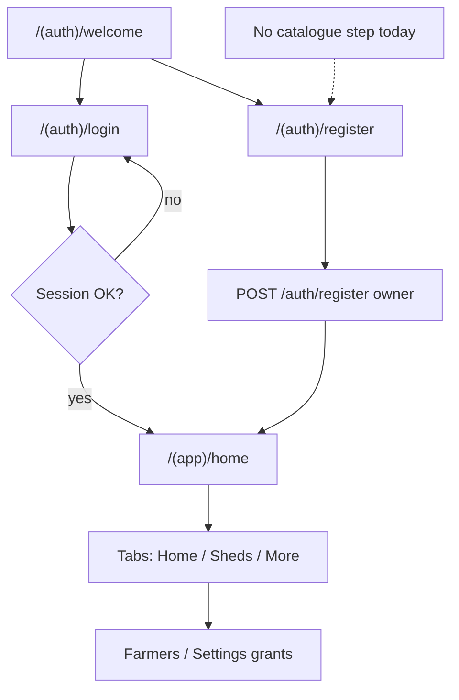
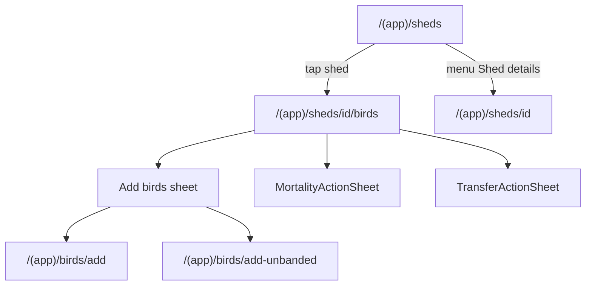
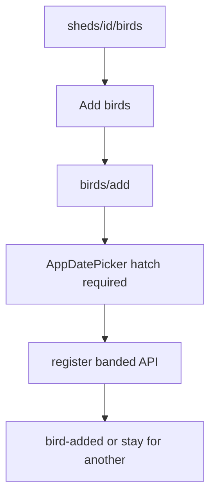
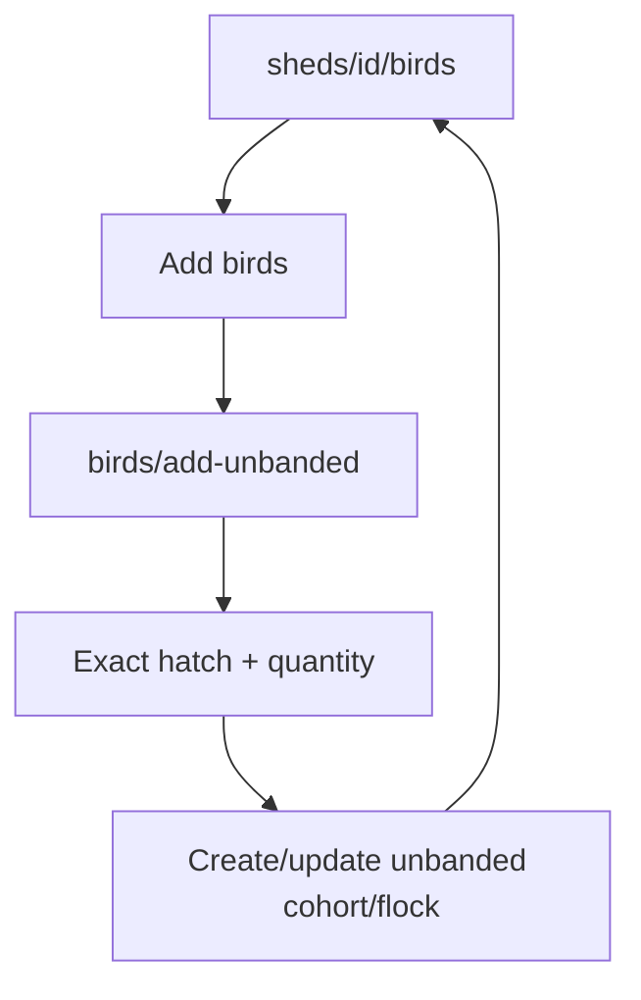
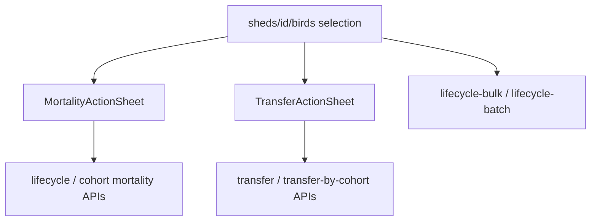
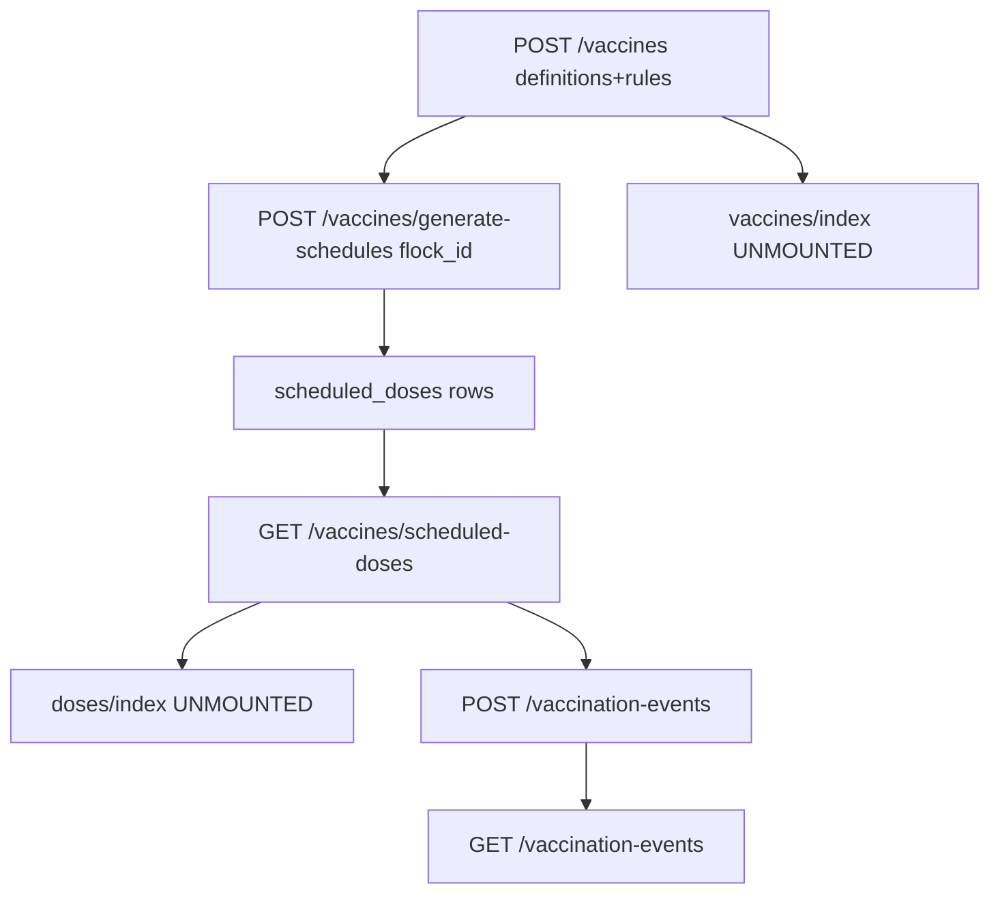
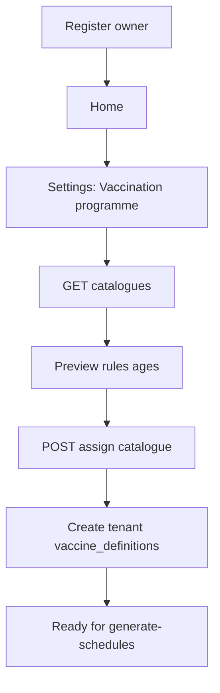
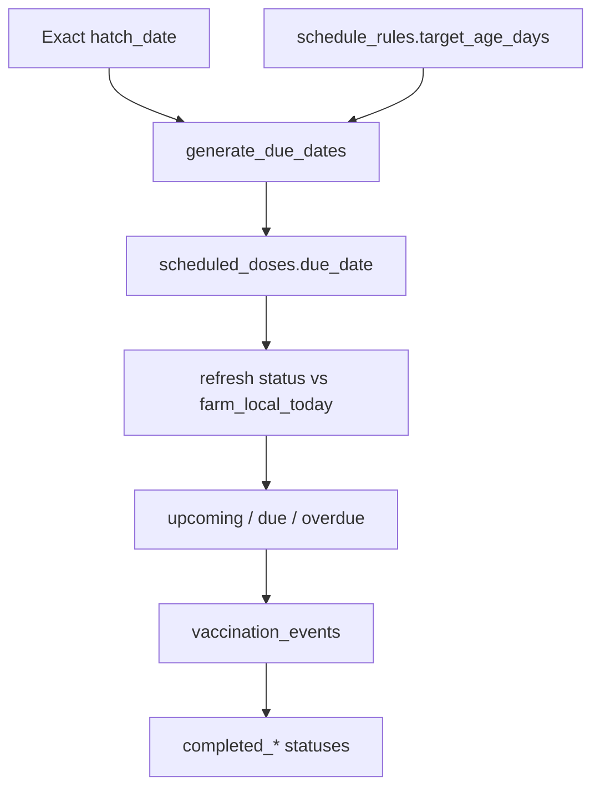
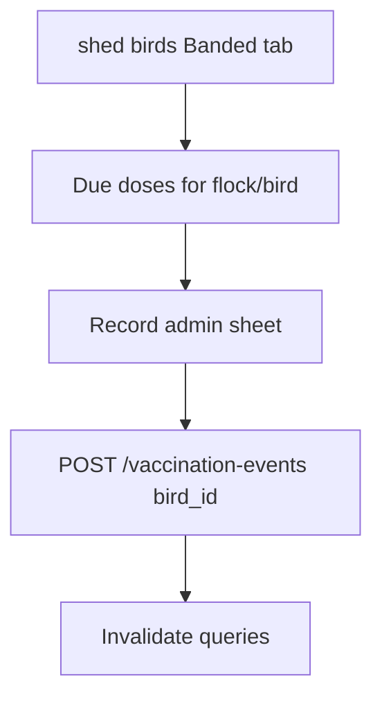
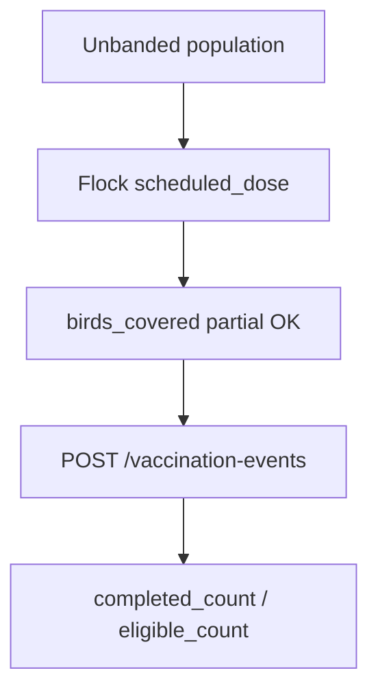

# Vaccine Module — Current Flow Audit & Implementation Plan

**Status:** Approach A redesign approved (2026-10-23). Phase 0 documentation + schema verification complete; implementation not started until Phase 0 report is accepted.  
**Audience:** Implementers extending catalogue-driven UX on the existing vaccination backend.  
**Stack (locked):** Expo/React Native mobile + FastAPI/PostgreSQL backend — not Flutter/Supabase (`docs/open-decisions.md` C1).  
**Binding decisions:** `docs/open-decisions.md` D1–D10, A1, **A2′**, V1–V10.

---

## Table of contents

0. [Phase 0 — Approved redesign (2026-10-23)](#0-phase-0--approved-redesign-2026-10-23)
1. [Executive summary](#1-executive-summary)
2. [Key architectural decisions](#2-key-architectural-decisions)
3. [Part 1 — Current application](#3-part-1--current-application)
4. [Part 2 — Vaccine module requirements](#4-part-2--vaccine-module-requirements)
5. [Part 3 — Status and operational rules](#5-part-3--status-and-operational-rules)
6. [Part 4 — Database, API, security](#6-part-4--database-api-security)
7. [Part 5 — Phased implementation roadmap](#7-part-5--phased-implementation-roadmap)
8. [Part 6 — Diagrams and examples](#8-part-6--diagrams-and-examples)
9. [Test matrix and acceptance criteria](#9-test-matrix-and-acceptance-criteria)
10. [Prioritized checklist and open approvals](#10-prioritized-checklist-and-open-approvals)
11. [Source index](#11-source-index)

---

## 0. Phase 0 — Approved redesign (2026-10-23)

### 0.1 Product decisions (locked)

See `docs/open-decisions.md` (**A2′**, **V1–V10**). Summary:

- Platform + farm-created catalogues; platform is clone-then-edit only.
- Farm default assignment + optional flock override; flock create preselects default (no new onboard screen).
- Reuse `schedule_engine`; Tasks inbox + one Confirm recording flow.
- Optional structured manufacturer/brand and strain; history on bird/flock profiles.
- Consolidate Vaccination programme / orphan Vaccines / competing plan entry points.
- Preserve events, corrections, D5, idempotency, tenancy; no table drops until dependency proof.

### 0.2 Schema verification against live models/migrations (facts)

Verified against:

- `backend/alembic/versions/0004_phase4_to_8_vaccines_media.py`
- `backend/alembic/versions/0008_vaccine_catalogues.py`
- `backend/app/models/catalogue.py`, `vaccine.py`, `vaccination.py`, `flock.py`
- Latest alembic head: **`0008_vaccine_catalogues`** (next revision must be `0009_…`)

| Object | Current fact | Implication for Approach A |
|------|--------------|----------------------------|
| `vaccine_catalogues` | **No** `owner_account_id`; global `UniqueConstraint("code")` `uq_vaccine_catalogues_code` | Farm-owned catalogues **require** migration: nullable `owner_account_id`, replace global code unique with partial uniques |
| Platform grants (0008) | `GRANT SELECT` only on catalogue tables to `app_user` | Farm CRUD needs INSERT/UPDATE/DELETE + RLS on owner-owned rows; platform rows remain non-updatable by tenants |
| `owner_catalogue_assignments` | Farm default assignment + RLS | **Reuse** as farm default (A2′) |
| `flocks` | **No** catalogue FK | Add nullable `vaccination_catalogue_id` → `vaccine_catalogues.id` |
| `vaccine_definitions.source_catalogue_item_id` | Partial unique per `(owner_account_id, source_catalogue_item_id)` | Clone must create **new** item IDs (or clear source links carefully); materialize path stays valid |
| `scheduled_doses` | Separate from events; flock-scoped typical | **Reuse**; do not merge with events |
| `vaccination_events` | Has `lot_number`, `product_expiry`, `route`, `dose_amount`, `notes`, `idempotency_key` UNIQUE | **Reuse** those columns |
| `vaccination_events` manufacturer / strain | **Absent** in model and 0004 | **Add** nullable structured columns |
| Batch record API | `VaccinationBatchRecordIn` has `notes` only; service sets `lot_number=None`, `product_expiry=None` | API/service extension required (no new columns for lot/expiry) |
| Catalogue CRUD API | GET + assign/preview only | New endpoints required for create/clone/update (extend same router) |
| `VaccineCatalogue.version` | Integer column exists | Reuse for farm catalogue version bumps under D5 |

### 0.3 Confirmed schema changes (proposed migration `0009`)

**Additive only.** No drops of vaccination/catalogue/dose/event tables.

1. **`vaccine_catalogues`**
   - Add `owner_account_id UUID NULL` FK → `owner_accounts` (`ON DELETE CASCADE`); `NULL` = platform.
   - Add `cloned_from_catalogue_id UUID NULL` FK → `vaccine_catalogues` (`ON DELETE SET NULL`).
   - Add `created_by_user_id UUID NULL`.
   - Drop `uq_vaccine_catalogues_code`.
   - Add partial unique: platform codes `UNIQUE (code) WHERE owner_account_id IS NULL`.
   - Add partial unique: farm codes `UNIQUE (owner_account_id, code) WHERE owner_account_id IS NOT NULL`.
   - Enable RLS for rows with `owner_account_id IS NOT NULL` (tenant policy); platform rows readable by all authenticated app paths (keep SELECT grant / bypass as today).

2. **`flocks`**
   - Add `vaccination_catalogue_id UUID NULL` FK → `vaccine_catalogues` (`ON DELETE SET NULL` or `RESTRICT` — prefer **RESTRICT** while assignment active; validate catalogue is platform-or-same-owner before write).
   - Index `(owner_account_id, vaccination_catalogue_id)`.

3. **`vaccination_events`**
   - Add `manufacturer_or_brand VARCHAR(128) NULL`.
   - Add `vaccine_type_or_strain VARCHAR(128) NULL`.

4. **Grants**
   - Extend `app_user` privileges for owner-owned catalogue write paths as required by RLS design.

5. **Backfill**
   - Existing catalogues remain `owner_account_id NULL` (platform).
   - Existing assignments unchanged.
   - All flocks `vaccination_catalogue_id NULL` (inherit farm default).
   - New event columns NULL.

**Explicitly not in `0009`:** dropping `vaccines` APIs, deleting `vaccine_definitions`, merging doses into events, mandatory manufacturer/strain.

### 0.4 Migration plan (sequence)

| Step | Action | Rollback |
|------|--------|----------|
| 1 | Land `0009` additive migration + model updates | Downgrade drops only new columns/constraints/FKs |
| 2 | Catalogue CRUD + clone API; ownership checks | Feature-flag or unused endpoints |
| 3 | Resolve effective catalogue (flock override → farm default) in `ensure_schedules_for_flock` | Inherit-only if override ignored |
| 4 | Batch/single record product fields + Confirm UI | Old clients omit new fields |
| 5 | Flock create catalogue picker; bird/flock history UI | Hide UI; data intact |
| 6 | Consolidate nav; dependency proof before hiding Vaccines / programme | Restore hrefs |

**Data-loss policy:** never `TRUNCATE`/`DELETE` `vaccination_events`, `vaccination_corrections`, or completed dose history as part of this redesign.

### 0.5 Test strategy (per phase)

| Phase | Backend | Mobile |
|-------|---------|--------|
| 1 Schema/API | New migration verify script; extend `test_vaccine_catalogues.py` (clone, owner CRUD, RLS, code uniqueness); existing assign/D5 tests still green | — |
| 2 Catalogues UX | Permission matrix `schedule.manage` vs farmer | Catalogue list/create/clone/set default |
| 3 Onboarding | Flock create with default + override; `ensure_schedules` uses effective catalogue | `flocks/create` picker only (no new screen) |
| 4 Recording | Batch persists lot/expiry/manufacturer/strain/notes; idempotent replay | Confirm fields + stable idempotency key |
| 5 History | Profile/PDF unchanged contract | Bird + flock history sections |
| 6 Cleanup | Grep consumers of retired entry points; no delete until zero | Nav consolidation |

**Regression anchors (must stay green):** `test_phase4_8_vaccines.py`, `test_vaccine_catalogues.py`, `test_vaccine_module_qa.py`, shed transfer / notification tests that touch doses.

### 0.6 Phase status

| Deliverable | Status |
|-------------|--------|
| Product decisions written (`open-decisions.md` A2′, V1–V10) | **Done** (Phase 0) |
| Schema verified vs models/migrations | **Done** (Phase 0) |
| Migration `0009` authored + disposable verify script | **Done** (Phase 1; not applied to production app DB by this work) |
| Catalogue CRUD/clone + flock override + batch product fields (API) | **Done** (Phase 1) |
| Mobile UI / onboarding / nav consolidation | **Not started** (Phase 2+) |

---

## 1. Executive summary

PoultryTrack already has a **substantial vaccination backend**: versioned vaccine definitions, schedule rules with `target_age_days`, persisted `scheduled_doses`, administration events with partial population coverage, corrections, notifications, and compliance reports. Due dates are computed as:

```text
due_date = exact_hatch_date + target_age_days   # date-only arithmetic
```

in `backend/app/services/schedule_engine.py` (`generate_due_dates`). Status uses the **farm-local calendar** (`farm_local_today`, decision D2).

**Current shipped baseline (do not treat older “missing catalogue” rows as true):** platform catalogues + farm assign (`0008`), Tasks tab + Confirm, flock auto `ensure_schedules_for_flock`, schedule engine statuses. See §12 and §0.

**Remaining gaps for the approved redesign (Approach A):**

| Gap | Evidence |
|-----|----------|
| No farm-owned / user-created catalogues | `vaccine_catalogues` has no `owner_account_id`; catalogues API is assign-only |
| No flock catalogue override | `flocks` model has no `vaccination_catalogue_id` |
| No catalogue picker on flock create | `flocks/create.tsx` / `FlockCreate` — DOB only |
| Competing catalogue UX | More → Vaccination programme; orphan `vaccines/index`; Tasks “Create vaccination plan” |
| Confirm omits product fields | Confirm batch payload date + coverage only; batch service nulls lot/expiry |
| No manufacturer/strain columns | Absent on `vaccination_events` |
| Bird/flock history UI incomplete | Profile API returns vaccinations; `birds/[id].tsx` does not render them |
| Home dashboard dose metrics paused | `dashboard_service.py` hard-coded zeros |
| Stale schema docs | `docs/database-schema.md` still drifts from Alembic |

**Recommendation (approved):** Approach A — extend catalogues/assignments/events; redesign UI around one Catalogues experience + Tasks + Confirm + history; keep `schedule_engine` and existing history tables.

---

## 2. Key architectural decisions

These bind the plan unless product revises them (see [§10](#10-prioritized-checklist-and-open-approvals) for items needing explicit approval).

| ID | Decision | Rationale |
|----|----------|-----------|
| **A1** | **Day-number offset:** `target_age_days` = days **after** hatch. Hatch day vaccine ⇒ `target_age_days = 0`. A “Day 1” label in a catalogue UI must map explicitly (prefer: Day 1 = hatch ⇒ offset 0). | Matches existing `hatch_date + timedelta(days=target_age_days)` in `schedule_engine.generate_due_dates`. Do not reinvent. |
| **A2′** | **Catalogue scope (revised 2026-10-23):** Farm **default** via `owner_catalogue_assignments` + optional **flock override**. Platform + farm-created catalogues; platform is **clone-then-edit**. | Supersedes farm-only A2; see `open-decisions.md` A2′, V1–V3. |
| **A3** | **Persist schedule instances** (`scheduled_doses` rows), refresh status on read. | Already implemented; supports partial `eligible_count` / `completed_count`, notifications, reports. |
| **A4** | Auto due dates need resolvable hatch (exact or estimated→hatch). Unknown/null ⇒ `needs_review`, not invented dates. | Engine behaviour; estimated age still supported. |
| **A5** | **History immutable on catalogue change:** never rewrite `vaccination_events`; regenerate only eligible future doses with D5 scope rules. | Locked as D5 in `docs/open-decisions.md`. |
| **A6′** | **Operational UX (revised):** Tasks tab = vaccination inbox; one Confirm recording flow; Catalogues consolidated under one manage surface. Shed birds remain population management, not a second catalogue home. | Aligns V5, V9. |
| **A7** | **Unbanded:** continue flock-level doses + `birds_covered` partials. Do not claim individual bird identity from coverage counts. | V8 + existing `vaccination_service`. |
| **A8** | Date-only math must use local/farm calendar helpers — **never** `toISOString().slice(0,10)` for due dates. | Mobile: `selectUtils.formatIsoDate` / `todayIsoDate`; backend: `date` + `farm_local_today`. |

---

## 3. Part 1 — Current application

### 3.1 Application architecture

| Area | Verified detail | Paths |
|------|-----------------|-------|
| Mobile | Expo **~57**, RN **0.86**, TypeScript, **expo-router**, TanStack Query, RHF/Zod | `mobile/package.json`, `mobile/app/_layout.tsx`, `mobile/app/index.tsx` |
| Entry | `expo-router/entry`; auth gate in `(app)/_layout` | `mobile/app/(app)/_layout.tsx`, `mobile/app/(auth)/*` |
| Auth | Email/password; JWT + refresh; Secure Store session | `mobile/src/features/auth/AuthContext.tsx`, `mobile/src/api/auth.ts`, `backend/app/api/v1/auth.py` |
| Roles | `owner`, `org_admin`, `farmer`, `read_only` + explicit permission grants | `docs/permissions-matrix.md`, `backend` membership models, `mobile/src/features/auth/permissions.ts` |
| Backend | FastAPI modular monolith, SQLAlchemy 2, Alembic, PostgreSQL RLS | `backend/app/main.py`, `backend/app/api/v1/__init__.py`, `docs/architecture.md` |
| API style | REST under `/api/v1/...`; thin routers → services | e.g. `vaccines.py` → `vaccine_service.py` |
| UI theme | Tokens + bird management UI kit | `mobile/src/theme/tokens.ts`, `mobile/src/theme/birdManagementUi.ts`, `mobile/src/components/ui/*` |
| Dates | Shared ISO date helpers + `AppDatePicker` | `mobile/src/components/ui/selectUtils.ts`, `AppDatePicker.tsx` |
| Backend tests | pytest | `backend/app/tests/` (e.g. `test_phase4_8_vaccines.py`) |
| Mobile tests | Lightweight Node helper tests (no Jest suite) | `mobile/src/**/__tests__/*.node-test.mjs` |
| Migrations | Alembic numbered revisions | `backend/alembic/versions/0001_…` … `0007_…` |

**Primary tabs (mounted):** Home, Sheds (if `shed.view`), More/settings.  
**Hidden but present:** Populations/flocks, Vaccines, Tasks/doses, shed overview, bird flows, lifecycle screens (`_layout.tsx`).

### 3.2 Onboarding and access

**Verified flow**

1. `/(auth)/welcome` → login or register.
2. **Register** (`/(auth)/register`): `full_name`, `organization_name`, `email`, `password` → `registerOwner` → `/(app)/home`.
3. **Login** restores session via Secure Store + `/auth/me`.
4. Owner account created at registration; permissions for owner are implicit full set; farmers get shed assignments + grants later (`/(app)/farmers/*`).

**Not present today**

- No vaccine catalogue step.
- No mandatory timezone setup in register UI (timezone exists on `owner_accounts` for D2 — configure elsewhere / defaults).
- No multi-step “farm setup wizard” beyond create-org.

**Insertion point for catalogue (recommended):**  
Post-register **optional setup** (or first visit to Settings → Vaccination programme) **before** relying on dose generation — see §4.1. Do not block shed creation if catalogues are empty (owner can create definitions manually as today).

### 3.3 Sheds and bird management

| Step | Route / UI | Notes |
|------|------------|-------|
| Shed list | `/(app)/sheds` | `mobile/app/(app)/sheds/index.tsx` |
| Tap shed | → `/(app)/sheds/[id]/birds` | **Skips** overview by default; overview still at `sheds/[id]/index` via menu “Shed details” |
| Bird mgmt | Consolidated screen | Counts, Banded/Unbanded tabs, search, selection, Add birds, mortality/transfer sheets |
| Add birds | Sheet → banded / unbanded | `birds/add`, `birds/add-unbanded` |
| Mortality / transfer | Bottom sheets | `MortalityActionSheet.tsx`, `TransferActionSheet.tsx`; also `birds/transfer`, `lifecycle-bulk`, `lifecycle-batch` |

Internal **flock/batch** remains the backend population unit (`docs/bird-onboarding-and-shed-assignment.md`) but should stay secondary in UI copy (“hatch-date population” / batch code).

### 3.4 Bird registration and lifecycle

| Flow | Screen(s) | Hatch / age | API (representative) |
|------|-----------|-------------|----------------------|
| Banded register | `birds/add.tsx` | **Exact hatch required** via `AppDatePicker` | Shed-centric banded register APIs in `mobile/src/api/birds.ts` |
| Unbanded headcount | `birds/add-unbanded.tsx` | **Exact hatch required** | Cohort/unbanded create paths |
| Legacy / group | `birds/new-group.tsx`, `flocks/create.tsx` | Exact or estimated chips still exist on some paths | `POST /flocks` |
| Band from unbanded | `birds/band-from-unbanded.tsx` | Inherits flock hatch | Birds API |
| Edit | `birds/edit/[id].tsx` | Hatch / estimated | Bird update |
| Mortality | Sheets + profile + bulk/batch | Effective date | `POST /lifecycle-events` (+ cohort variants) |
| Transfer | Sheets + `birds/transfer.tsx` | Effective date; cohort-aware | Transfer / cohort transfer APIs |

**Important for vaccination:** Schedule generation today keys off **`flocks.hatch_date`** and **`flocks.dob_confidence`**, not individual `birds.hatch_date` (even when banded birds store hatch).

### 3.5 Existing vaccination functionality inventory

| Feature | Classification | Notes |
|---------|----------------|-------|
| `vaccine_definitions` + versions + `schedule_rules` | **Implemented and active** (API) | Per-tenant catalogue items |
| `POST/GET /vaccines`, archive, new versions | **Active** | `schedule.manage` / `schedule.view`; D5 `apply_scope` on versions |
| `POST /vaccines/generate-schedules` | **Active** | Flock-scoped; **not** auto-called on flock create |
| `GET /vaccines/scheduled-doses` (+ status refresh) | **Active** | `vaccination.view` |
| `scheduled_doses` persistence + status engine | **Active** | `schedule_engine.py`, `vaccine_service.py` |
| `POST/GET /vaccination-events`, correct | **Active** | Partial `birds_covered`, idempotency |
| Notifications / compliance reports | **Active** (API) | `notifications`, `reports`; prod cron for generate **Requires verification** |
| Bird vaccination PDF | **Active** (API) | `GET /birds/{id}/vaccination-report.pdf` (`bird.view`) |
| Bird profile dose snippets | **Active** | `flock_service.get_bird_profile` |
| Shed list/overview dose-task buckets | **Active** | `shed_service` overdue/due_today/upcoming/needs_review |
| Dashboard dose metrics | **Implemented but paused** | Hard-coded zeros in `dashboard_service.py` |
| Mobile `vaccines/index`, `doses/index` | **Implemented but unmounted/paused** | Hidden tabs; deep-linkable; no primary nav |
| Mobile catalogue create UX | **Partial** | Single age-day rule only; no version/repeat/archive UI |
| D5 preview-before-apply | **Partial** | Scope + effective date required; no dedicated preview endpoint |
| Platform shared catalogues / `vaccine_program` | **Missing** | No global template tables |
| Onboarding catalogue picker | **Missing** | |
| Shed bird-mgmt vaccination summary | **Missing** | On `…/birds` (distinct from shed overview buckets) |
| Auto-schedule on flock/bird create | **Missing** | |
| Per-banded-bird dose rows | **Partial** | Column exists; generator creates flock-level (`bird_id IS NULL`) |
| Exact-hatch-only product rule | **Partial** | Engine + some mobile flows; flock create still allows estimated |
| Docs-only tables (`vaccination_event_outcomes`, `notification_deliveries`) | **Missing** | Stale `docs/database-schema.md` — do not implement unless product asks |

### 3.6 Current-flow diagrams

#### Login / onboarding / access



#### Shed selection and bird management



#### Banded bird registration



#### Unbanded population registration



#### Mortality and transfer



#### Existing vaccination-related flow (backend + paused UI)



---

## 4. Part 2 — Vaccine module requirements

### 4.1 Catalogue selection during onboarding / setup

**Approved (2026-10-23):** See **A2′**, **V1–V3**, **V9**.

1. Catalogues manager (evolved from Vaccination programme): list platform + farm catalogues; **clone** platform to edit; create farm catalogues; set farm **default** assignment (D5 preview on change).
2. **Flock create** (existing screen only): preselect farm default; optional override → persist `flocks.vaccination_catalogue_id`; then existing `ensure_schedules_for_flock`.
3. Materialize effective catalogue → tenant definitions → scheduled doses via existing engine.
4. Never delete `vaccination_events` on catalogue change (D5 / A5).

Do **not** add a second onboarding screen. Do **not** put catalogue selection inside farmer login.

### 4.2 Catalogue and schedule structure

#### Existing (reuse)

| Entity | Table | Mandatory fields (practical) | Optional |
|--------|-------|------------------------------|----------|
| Definition | `vaccine_definitions` | `owner_account_id`, `name` | `category`, `description`, `instructions` |
| Version | `vaccine_schedule_versions` | `version_number`, `effective_date`, `is_current` | `notes` |
| Rule | `schedule_rules` | `dose_number`; at least one of `target_age_days` / `repeat_interval_days` | `max_repeats`, `grace_period_days`, `reminder_lead_days`, `label`, `is_manual_only` |
| Dose instance | `scheduled_doses` | shed/flock, vaccine refs, `due_date`, `status`, counts | `bird_id`, `needs_review` |
| Event | `vaccination_events` | shed/flock, vaccine, `administration_date`, `birds_covered`, recorder | lot, route, notes, `bird_id`, `scheduled_dose_id` |

#### Proposed (new) — programme templates

Introduce **platform or admin-managed catalogues** (names illustrative):

| Entity | Purpose | Mandatory | Optional |
|--------|---------|-----------|----------|
| `vaccine_catalogues` | Programme header | `code`, `name`, `status`, `version` | `description`, `effective_from/to` |
| `vaccine_catalogue_items` | Links template vaccines/rules | `catalogue_id`, ordered items | disease labels, route hints |
| `owner_catalogue_assignments` | Farm selection | `owner_account_id`, `catalogue_id`, `assigned_at`, `assigned_by` | `notes` |

**Materialization:** On assign, create/update tenant `vaccine_definitions` (+ version 1 rules) from catalogue items so existing generate/record APIs keep working.

**Do not hardcode** vaccine names/ages in mobile UI — always load from API.

*Illustrative only (not veterinary advice):* a catalogue item “Gumboro” with rules `target_age_days=0` and `target_age_days=20` if Day 1 = hatch and Day 21 = hatch+20 under convention A1.

### 4.3 Exact hatch and due-date calculations

**Locked convention (A1)**

| Catalogue wording | Stored `target_age_days` | Example hatch `2026-10-01` |
|-------------------|--------------------------|----------------------------|
| Day 1 = hatch day | `0` | Due `2026-10-01` |
| Day 21 = 20 days after hatch | `20` | Due `2026-10-21` |
| “21 days of age” if defined as hatch+21 | `21` | Due `2026-10-22` |

Catalogues must document which wording they use; the engine always applies **elapsed-day offset**.

**Formula (existing):** `due_date = hatch_date + target_age_days`  
**Not** registration date, transfer date, or “today”.

**Timezone:** Compare status with `farm_local_today(owner.timezone)` (D2). Mobile display/API date-only fields use local ISO helpers.

**Test cases (required)**

| Case | Expected |
|------|----------|
| Valid exact hatch | Dues generated; statuses from today vs due |
| Registered days after hatch | Still hatch-based dues (may already be overdue) |
| Transferred bird/population | History retained; visibility follows shed access; regenerate/move policy TBD (approve) |
| Hatch date edited | Future open doses recalculated; completed events unchanged |
| Farm with programme | Generate for flocks with exact hatch |
| Catalogue changed | D5 scope; no silent rewrite of events |
| Overdue / completed / future | Status engine vocabulary |
| Missing/invalid DOB | `needs_review` / unavailable — no fake dues |
| Day boundary | Farm TZ midnight vs UTC |

### 4.4 Banded vs unbanded

#### Banded

**Today:** Population doses at flock level; recording can attach `bird_id` optionally; mobile doses UI often records `birds_covered` against flock dose.

**Target:**

- Prefer **per-bird scheduled doses** when tracking individual bands **or** keep flock dose + require bird selection when recording — **needs product approval** (see §10).
- Safest incremental path: keep flock-level generation; when recording for banded selection, pass `bird_id` and `birds_covered=1`, and track completion carefully to avoid double-counting.

#### Unbanded

**Today (reuse):** `eligible_count = flock.current_count`; `completed_count` increments by `birds_covered`; partial leaves dose open.

**Must handle**

- Quantity changes (mortality/transfer) — **gap:** eligible_count may go stale; plan refresh on lifecycle (phase 2/4).
- Exact hatch on flock/cohort.
- Partial vaccination visible as `completed_count / eligible_count`.
- No claim of “fully vaccinated” until counts meet.

### 4.5 Vaccination UI (proposed — no code in this task)

**Shed bird-mgmt additions (compact)**

- Strip: Due today · Overdue · Upcoming (tap → dose list sheet/screen).
- Filter chips on dose list: status, vaccine, banded/unbanded.
- Record via bottom sheet (reuse `AppDatePicker` for administration date).
- History link on bird profile / population.

**Avoid:** restoring global Tasks/Vaccines tabs as primary navigation; avoid one screen per micro-action.

#### Textual wireframes

**Programme setup**

```text
[ Vaccination programme ]
  Catalogue cards: name, short description
  [ Preview schedules ] → list vaccine · age · dose #
  [ Select for this farm ]   secondary: Change later in Settings
```

**Shed birds header addition**

```text
Live 12 · Banded 4 · Unbanded 8
Vaccination  Overdue 2 · Due today 1 · Upcoming 5   [View]
```

**Record administration sheet**

```text
Vaccine / dose label
Population or band list
Admin date [AppDatePicker]
Birds covered [n]   (unbanded)
[ Confirm ] [ Cancel ]
```

---

## 5. Part 3 — Status and operational rules

### Calculated instance vs administration record

| | `scheduled_doses` | `vaccination_events` |
|--|-------------------|----------------------|
| Meaning | Planned instance | Historical fact |
| Completion | Via events updating `completed_count` / status | Immutable except void/correct |
| Past due alone | **Does not** complete | N/A |

### Display statuses (existing engine vocabulary)

Map for UI copy:

| Engine status | UI label suggestion |
|---------------|---------------------|
| `upcoming` | Upcoming |
| `due_soon` | Due soon |
| `due_today` | Due today |
| `overdue` | Overdue |
| `completed_on_time` / `completed_late` / `completed_timing_unknown` | Administered |
| `needs_review` | Unknown / needs DOB |
| `not_applicable` / `inactive` / `skipped` | Not applicable |

### Operational events

| Event | Rule |
|-------|------|
| Catalogue change | D5: scope + effective date + preview; preserve events; regen future |
| Schedule version update | Same as D5; `create_new_version` already regenerates selected flocks |
| Hatch corrected | Recalc open future doses; leave events |
| Mortality | Reduce live counts; void or N/A open doses for dead birds if bird-level; flock eligible refresh |
| Transfer | Access follows destination shed; decide whether doses move with flock/bird (approve) |
| No hatch | No auto dues; show unavailable |

### Generation strategy

**Keep persisted doses (A3).** Dynamic-only calculation would break partial counts, notifications, and idempotent recording already built.

### Duplicates / corrections

- Idempotency keys on events (existing).
- `POST /vaccination-events/{id}/correct` + `vaccination_corrections` audit (existing).
- Unique-ish natural key on generate: flock + rule + due_date + `bird_id IS NULL` (existing skip-if-exists).

---

## 6. Part 4 — Database, API, security

### 6.1 Database

#### Existing (do not duplicate)

From migration `0004_phase4_to_8_vaccines_media.py` and models:

- `vaccine_definitions`, `vaccine_schedule_versions`, `schedule_rules`
- `scheduled_doses` (indexes on owner, due_date, status, FKs)
- `vaccination_events`, `vaccination_corrections`
- notifications tied to doses

#### Proposed additions (plan only — no migration in this task)

1. `vaccine_catalogues` (+ items/rules templates) — nullable `owner_account_id` for platform rows.  
2. `owner_catalogue_assignments` — current programme per farm.  
3. Optional: `scheduled_doses.eligible_count` refresh triggers/jobs after lifecycle.  
4. Optional later: unique constraint including `bird_id` when per-bird doses ship.

**Rollback:** additive tables first; assignment nullable; keep generating without catalogue if definitions exist.

### 6.2 API

#### Existing (reuse)

| Method | Path | Permission |
|--------|------|------------|
| POST/GET | `/vaccines` | schedule.manage / view |
| POST | `/vaccines/{id}/archive` | schedule.manage |
| POST | `/vaccines/{id}/versions` | schedule.manage |
| POST | `/vaccines/generate-schedules` | schedule.manage |
| GET | `/vaccines/scheduled-doses` | vaccination.view |
| POST | `/vaccines/refresh-statuses` | (see API file) |
| POST/GET | `/vaccination-events` | vaccination.record / view |
| POST | `/vaccination-events/{id}/correct` | vaccination.correct |
| GET | `/reports/compliance` | reports permissions |
| GET/POST | `/notifications`… | notifications |

#### Proposed (label: **new**)

| Operation | Sketch | Auth |
|-----------|--------|------|
| List catalogues | `GET /vaccine-catalogues` | authenticated; schedule.view to preview |
| Catalogue detail | `GET /vaccine-catalogues/{id}` | schedule.view |
| Assign programme | `POST /owners/me/vaccine-catalogue` `{ catalogue_id }` | schedule.manage |
| Get assignment | `GET /owners/me/vaccine-catalogue` | schedule.view |
| Shed vaccination summary | `GET /sheds/{id}/vaccination-summary` | vaccination.view + shed access |
| Auto-generate after bird/flock create | hook or `POST .../generate-schedules` from mobile | schedule.manage or system rule |

Validate: tenant isolation, shed membership for farmers, reject cross-farm catalogue mutation.

### 6.3 Permissions and security

| Action | Who |
|--------|-----|
| Assign/change catalogue | `schedule.manage` (owner; org_admin if granted) |
| Create custom definitions | `schedule.manage` |
| View doses | `vaccination.view` (+ shed scope for farmers) |
| Record vaccination | `vaccination.record` |
| Correct | `vaccination.correct` |

Enforce in FastAPI `require_permission` + shed asserts + RLS — **not** UI hiding alone (`docs/security-plan.md`).

---

## 7. Part 5 — Phased implementation roadmap

### Phase 0 — Current-state audit *(this document)*

- **Goals:** Inventory flows, schema, paused UI, decisions.  
- **DoD:** Plan merged into `docs/`; open approvals listed.  
- **Risks:** None (docs only).

### Phase 1 — Catalogue foundation

- **Goals:** Template catalogues + farm assignment + materialize tenant definitions; setup/settings UI.  
- **Likely files:** new migration; `models/`; `api/v1/`; `vaccine_service`; `mobile` settings + API client; seeds/tests.  
- **Tests:** assign clones rules; isolation; change catalogue preserves events.  
- **Acceptance:** Owner can select programme; definitions appear; farmer cannot assign.  
- **Depends on:** Phase 0 decisions A2, catalogue schema approval.

### Phase 2 — Age-based schedule calculation hardening

- **Goals:** Exact-hatch gate in product paths; generate on flock/cohort create; eligible_count refresh; TZ tests; document Day offset in API.  
- **Likely files:** `schedule_engine.py`, `vaccine_service.py`, flock/bird create hooks, lifecycle services.  
- **Acceptance:** Due dates match A1 examples; unknown hatch ⇒ needs_review; no UTC day shift.  
- **Depends on:** Phase 1 definitions present.

### Phase 3 — Shed vaccination UI

- **Goals:** Summary on `sheds/[id]/birds`; dose list + filters; deep link to paused screens only if needed.  
- **Likely files:** `sheds/[id]/birds.tsx`, new components, `vaccines.ts` client, theme.  
- **Acceptance:** Few-tap path Sheds → birds → due list; no primary Vaccines tab required.  
- **Depends on:** Phase 2 summary API or composed client queries.

### Phase 4 — Administration and history

- **Goals:** Record sheet; partial unbanded; banded selection; idempotency; corrections entry points.  
- **Likely files:** sheets, `doses` patterns reuse, `vaccination_service`.  
- **Acceptance:** Partial counts correct; duplicate submit safe; history intact.  
- **Depends on:** Phase 3 list UX.

### Phase 5 — Reporting, reminders, readiness

- **Goals:** Shed/farm compliance; optional notification generate from UI; perf + security regression; remount policy final.  
- **Acceptance:** Reports match engine; RLS tests green; docs updated.  
- **Depends on:** Phases 1–4.

**Why this order:** Cannot show trustworthy shed doses before programme + hatch-based generation; UI before recording wastes work; reports last.

---

## 8. Part 6 — Diagrams and examples

### Proposed onboarding / catalogue selection



### Proposed due-date lifecycle



### Proposed banded flow



### Proposed unbanded flow



### High-level architecture

```mermaid
flowchart LR
  subgraph Mobile
    ShedUI[sheds/id/birds]
    SetupUI[Programme setup]
    Date[AppDatePicker]
  end
  subgraph API
    Cat[Catalogues proposed]
    Vac[/vaccines]
    Ev[/vaccination-events]
  end
  subgraph Data
    Def[vaccine_definitions]
    Dose[scheduled_doses]
    Hist[vaccination_events]
  end
  SetupUI --> Cat --> Def
  ShedUI --> Vac --> Dose
  ShedUI --> Ev --> Hist
  Date --> ShedUI
```

### Sample due-date table (hypothetical data — not veterinary advice)

| Bird/population | Hatch date | Vaccine (example label) | Target age (`target_age_days`) | Calculated due date | Status (if today=2026-10-23) |
|-----------------|------------|-------------------------|--------------------------------|---------------------|------------------------------|
| Band B-100 | 2026-10-01 | Example IBD dose 1 | 0 | 2026-10-01 | Overdue (if open) |
| Band B-100 | 2026-10-01 | Example IBD dose 2 | 20 | 2026-10-21 | Overdue / due window |
| Unbanded cohort n=40 | 2026-10-20 | Example ND | 7 | 2026-10-27 | Upcoming |
| Flock missing hatch | — | Any | 14 | — | Needs review |

---

## 9. Test matrix and acceptance criteria

| Area | Automated | Manual |
|------|-----------|--------|
| `generate_due_dates` offsets / unknown hatch | pytest schedule/vaccine tests | — |
| Farm TZ status boundaries | pytest | — |
| Catalogue assign isolation | pytest RLS/tenant | — |
| Partial `birds_covered` | pytest vaccination | Emulator unbanded record |
| Hatch date ISO no UTC shift | mobile node date tests + backend dates | Emulator AppDatePicker |
| Shed summary UX | — | Emulator Sheds → birds → doses |
| Permissions | API negative tests | Farmer vs owner |

**Global acceptance**

1. Exact hatch drives dues; registration date does not.  
2. Catalogue change does not delete history.  
3. Farmers cannot assign catalogues.  
4. Unbanded partials never show fully complete early.  
5. Keyboard-safe date picking for admin/hatch dates.  
6. Existing Phase 4–8 vaccine tests remain green unless intentionally superseded.

---

## 10. Prioritized checklist and open approvals

### Checklist

1. [x] Day-offset mapping (A1): Day 1 = `target_age_days = 0`; catalogue rules store elapsed-day offsets.  
2. [x] Farm-level programme only (A2); no shed-level overrides.  
3. [x] Banded strategy: flock-level `scheduled_doses` + `bird_id` / coverage on `vaccination_events` (not per-bird dose rows).  
4. [x] Transfer: existing lifecycle + `refresh_open_dose_eligibility`; open doses remain flock-scoped.  
5. [x] Phase 1 catalogue schema + APIs (`0008_vaccine_catalogues`, `/api/v1/vaccine-catalogues`).  
6. [x] Phase 2 generate hooks + eligible refresh (`catalogue_service.ensure_schedules_for_flock` from flock/bird paths).  
7. [x] Phase 3 shed UI summary on `sheds/[id]/birds.tsx` → doses list.  
8. [x] Phase 4 record/history via existing doses/vaccination APIs + programme settings screen.  
9. [~] Phase 5 reports/reminders: existing services reused; dashboard live dose metrics still paused; cron deploy unverified.  
10. [~] Schema/permissions docs: this plan updated; full `database-schema.md` sync deferred.

### Decisions requiring product approval

1. **Catalogue packaging:** templates that clone into definitions (recommended) vs only “tag” existing definitions.  
2. **Banded dose granularity** (flock vs per bird).  
3. **Whether estimated-age flocks remain schedulable** in new UX (recommend: no auto dues).  
4. **Transfer:** move open doses with population vs regenerate at destination.  
5. **Whether to remount** global Vaccines tab for power users.

### Uncertain areas (verify during Phase 1)

- Whether production DBs already contain meaningful `vaccine_definitions` seeds.  
- Full mobile deep-link behaviour to hidden `doses/index` without tab.  
- Cohort APIs after `0007` vs flock_id assumptions in dose rows for pure unbanded cohorts.  
- Whether shed overview dose buckets should feed the new birds-screen summary API or be recomputed once.  
- When to re-enable live dashboard dose fields (must stay consistent with shed buckets).  
- Whether notification generation runs on a hosted cron (`docs/jobs.md`) in each environment.

---

## 11. Source index

| Topic | Paths |
|-------|-------|
| Architecture / decisions | `docs/architecture.md`, `docs/open-decisions.md`, `docs/implementation-plan.md` |
| Schema | `docs/database-schema.md`, `backend/alembic/versions/0004_phase4_to_8_vaccines_media.py` |
| Permissions | `docs/permissions-matrix.md`, `mobile/src/features/auth/permissions.ts` |
| Bird/shed model | `docs/bird-onboarding-and-shed-assignment.md` |
| Schedule engine | `backend/app/services/schedule_engine.py` |
| Vaccine / vaccination services | `backend/app/services/vaccine_service.py`, `vaccination_service.py` |
| APIs | `backend/app/api/v1/vaccines.py`, `vaccinations.py`, `__init__.py` |
| Models | `backend/app/models/vaccine.py`, `vaccination.py` |
| Tests | `backend/app/tests/test_phase4_8_vaccines.py` |
| Mobile vaccination UI (paused) | `mobile/app/(app)/vaccines/index.tsx`, `doses/index.tsx`, `_layout.tsx` |
| Mobile API | `mobile/src/api/vaccines.ts` |
| Dashboard pause | `backend/app/services/dashboard_service.py` |
| Shed dose buckets | `backend/app/services/shed_service.py` (`_task_bucket`, overview/list) |
| Bird PDF report | `backend/app/services/bird_report_service.py`, birds vaccination-report route |
| Shed bird mgmt | `mobile/app/(app)/sheds/[id]/birds.tsx`, `sheds/index.tsx` |
| Auth onboarding | `mobile/app/(auth)/register.tsx`, `login.tsx` |
| Mobile route/auth audit (supporting) | Expo Router tree under `mobile/app/`; `AuthContext.tsx`; permissions.ts |

---

## 12. Shipped implementation notes (Oct 2026)

| Area | Shipped behaviour |
|------|-------------------|
| Catalogues | Platform templates (`vaccine_catalogues` + items/rules); farm assignment via `owner_catalogue_assignments`; materialize → tenant `vaccine_definitions` / schedule versions / rules. |
| APIs | `GET` + assign/preview on `/api/v1/vaccine-catalogues*` (`schedule.view` / `schedule.manage`). **No** farm catalogue CRUD yet. |
| Generation | `due_date = hatch + target_age_days`; hooks on flock/bird create/update + catalogue assign (`all_active`). |
| Mobile | Settings → Vaccination programme; Tasks tab + Confirm; `doses/index` redirects; `vaccines/index` orphaned (`href: null`). |
| Banded / unbanded | Flock-level doses; events carry `bird_id` and/or `birds_covered`; no per-bird `scheduled_doses` rows. |
| Redesign (Approach A) | Approved; Phase 0 docs + schema verification done. Migration `0009` and UI/API work **not started**. |
| Deferred | Live dashboard dose zeros; full E2E QA; `database-schema.md` sync; hosted notification cron verification. |

---

*End of plan. Implementation must follow evidence above and locked decisions D1–D10 / A1 / A2′ / A3–A5 / A6′ / A7–A8 / V1–V10. Phase 0 (§0) gates schema work; do not treat planned migrations as applied until reported as done.*
